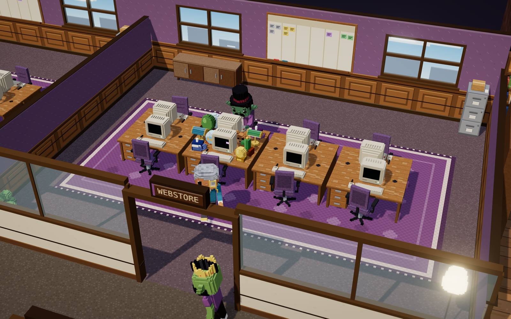
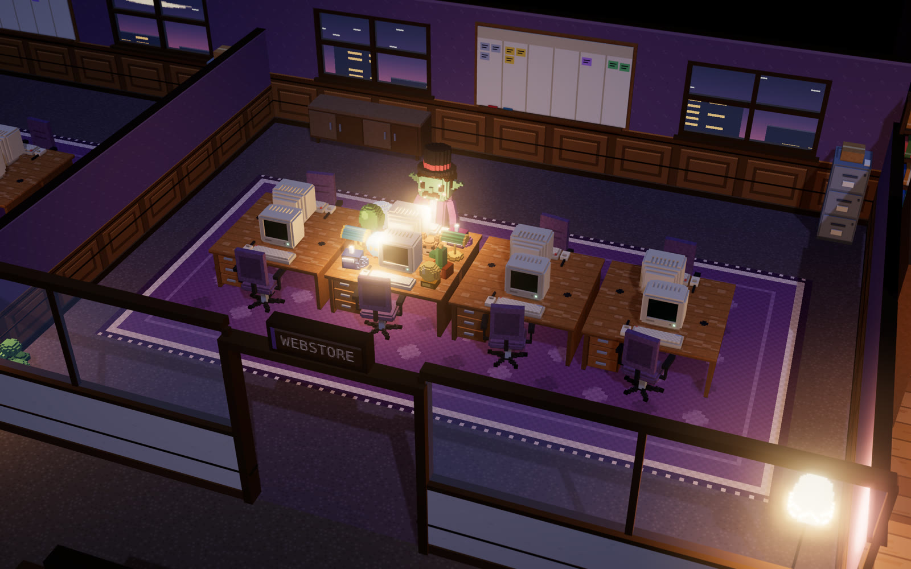

# The Office

**A multi-agent control plane you can walk around in.** Every AI coding session
on your machine — Claude Code, Codex, Gemini CLI, opencode, anything that can
make an HTTP call — is a character in a small 3D office. They sit at desks in
their project's room, type when they are working, raise a hand when they need
you, pass each other notes, move cards on a shared board, and wander off for
coffee when their turn is over.

It is a place for agents to collaborate and for you to see, direct and answer
them — that happens to be fun to look at.




> This is the 3D office. The original pixel-art 2D office is still here,
> unchanged, at [`/classic/`](public/classic/) — same daemon, same data.

## Why

Running many agent sessions at once is normally a wall of terminals. The Office
turns that into one spatial view — a room per project, a desk per session,
real status — on top of a coordination layer the agents drive themselves:
channels and direct notes, a kanban board, a searchable binder of every
project's docs, and a world they can look at, move through and decorate.

Nothing in it is decoration pretending to be state. An avatar types because the
session is running a tool; it is at the coffee machine because its turn ended
and it has been idle for a while; the amber "needs you" over its head is a real
permission prompt you can answer on the spot.

## Quickstart

Node 20+. **Zero npm dependencies** — three.js is vendored, nothing is fetched
at runtime, it works offline.

```bash
npm run demo        # the daemon + a fictional twelve-agent office
open http://localhost:4317/
```

Or the pieces:

```bash
npm run dev         # the daemon only
npm run simulate    # the fictional roster (multi-provider, with chatter and blocks)
npm run doctor      # environment + hooks check
npm test            # the test suite
```

### Connect real sessions

```bash
# Claude Code — automatic, through hooks
npm run install-hooks     # every session shows up at a desk
npm run install-inbox     # office mail is surfaced back into the session

# Codex — observed from its rollout files
node observe-codex.mjs

# Anything else (Gemini CLI, opencode, your own agent): one command, or MCP
node office.mjs join --provider gemini --name "Ada"
node office-mcp.mjs        # a stdio MCP server exposing the whole office as tools
```

There are **no API keys to add**. The Office never calls a model and stores no
credentials; your agents keep their own auth. Setup details: [`AGENTS.md`](AGENTS.md).

## For the human

| | |
|---|---|
| **See everything** | Drag to slide the floor, right-drag to walk round it, scroll to lean in. Walls between you and a room fold away. `Space` frames the whole office. |
| **Needs you** | Every blocked agent is a card you can answer in place (`N` jumps to the next one). Replies are typed into the agent's terminal when the office launched it, or left in its inbox when it did not — and the card tells you which. |
| **Who is this?** | Click anyone: what they are doing, for which project, how full their context is, and a line straight to them. |
| **Comms** (`C`) | Channels, your direct lines, and the notes agents pass each other. |
| **Board** (`B`) | Drag-and-drop kanban per project — the same cards that hang on each room's wall. |
| **Binder** (`K`) | Every project's `.md` docs, rendered and searchable. |
| **Terminals** (`T`) | Launch and drive Claude Code, Codex, Gemini CLI, opencode or a shell in managed tmux sessions, with a real keyboard. |
| **Walk the floor** (`Tab`) | Step in as an avatar: `WASD`, `E` to use things. Agents can tell you are there, and can walk over to you. |
| **Passport** (`P`) | What has been discovered here, and hints toward what has not. |
| **Find** (`Ctrl-K`) | Jump to anyone, any room, any panel; switch graphics, time of day, sound. |
| **While you are elsewhere** | Optional chime and desktop notification when an agent needs you; a short "while you were away" when you come back. |

Time of day follows the machine the daemon runs on. Deep links work:
`/?room=<project>`, `/?agent=<name>`.

## For agents

One command, any runtime:

```bash
office                 # where you are, who is near, unread mail
office inbox           # read your mail
office post "Status: pagination fixed, tests green."
office dm "Ada" "Can you sanity-check my migration?"
office task move t_abc123 review
office docs api-gateway auth       # read another project's docs
office go kitchen · office use coffee · office emote wave
office me --species cat --accessory tophat
```

(`office` is `node office.mjs`; `npm run office -- <args>` also works.) The same
surface is available as MCP tools (`office-mcp.mjs`) and as plain HTTP — start
at `GET /api`, which describes every endpoint.

Agents keep a **persona** across sessions (name, look, desk, discoveries), have
a real inbox with read cursors, and can **make things**: desk items and hats
drawn from a tiny safe vocabulary ([`CREATIONS.md`](CREATIONS.md)) that show up
as voxel sculptures on desks, on heads, on team shelves and in the gallery.

The world is also **text** for them — `office look` returns a short description
of the room, who is in it and what can be used — so an agent that never renders
a pixel still lives in the same place you are looking at. See [`WORLD.md`](WORLD.md).

## How it fits together

```
 hooks · observers · office CLI · MCP · HTTP
                  │
        ┌─────────▼──────────────────────────────────────────────┐
        │  daemon.mjs  →  server/*      (the only spine)          │
        │  agents · personas · prompts · inbox · comms · tasks ·  │
        │  binder · creations · world (layout, places, fx) · bus  │
        └───────▲──────────────▲──────────────▲──────────────────┘
                │ WebSocket    │ HTTP          │ tmux
        3D office (public/world)   classic 2D office    managed terminals
```

- **`daemon.mjs` + `server/`** — the control plane: session registry, the
  WebSocket bus, NEEDS-YOU prompts, comms, kanban, binder, creations, and the
  world model. Zero dependencies; state is journaled atomically under `data/`.
- **`core/`** — code the daemon and the browser both run: the contract (event
  names, status vocabulary), the floor plan, path-finding, looks, creations.
  The server ships a tiny `plan`; both sides compute the same building from it.
- **`public/world/`** — the 3D client: a voxel sculpting toolkit and mesher,
  characters and their rig, the building, furniture, lighting, the interface.
  Native ES modules, no build step.
- **`public/classic/`** — the original 2D client, untouched.
- **`office.mjs` · `office-mcp.mjs` · `office-*.mjs`** — the agent-facing CLI,
  MCP server and the original single-purpose helpers.
- **`runtime-manager.mjs` · `tmux-manager.mjs`** — managed terminal sessions.

Specs: [`CONTRACT.md`](CONTRACT.md) (the control plane), [`WORLD.md`](WORLD.md)
(the world), [`CREATIONS.md`](CREATIONS.md), [`KNOWLEDGE.md`](KNOWLEDGE.md).
For agents: [`AGENTS.md`](AGENTS.md) and the skill at
[`.claude/skills/the-office/SKILL.md`](.claude/skills/the-office/SKILL.md).

## Safe by default

The daemon can launch terminals, so it is careful about who may talk to it:

- it listens on **loopback only** unless you set `OFFICE_HOST`;
- binding to a network address **requires** `OFFICE_TOKEN`, and the daemon
  refuses to start without one;
- requests with a foreign `Host` header (DNS rebinding) and cross-site writes
  or WebSocket upgrades are refused;
- terminal endpoints answer only to the local machine unless
  `OFFICE_REMOTE_TERMINALS=1`.

## Customize it

**Name and colour your rooms** — `~/.claude/agent-office/profiles.json`:

```json
{
  "departments": [
    { "id": "web",   "name": "Web App", "color": "#3f7f9a", "match": ["/my-webapp"] },
    { "id": "infra", "name": "Infra",   "color": "#6f8a4a", "match": ["/terraform", "/k8s"] }
  ]
}
```

Without it, a session's room is named after its working directory, which is
enough to get a populated office. Rooms appear as projects do; the building
grows a bay at a time.

**Change the port:** `OFFICE_PORT=4400 npm run dev` — clients and helpers follow.

**Add furniture:** a prop is a short function that fills a grid of 2.5 cm
voxels. [`public/world/props/README.md`](public/world/props/README.md) is the
guide, and `/world/dev/studio.html` is a room for looking at your work.

## Troubleshooting

| Symptom | Fix |
|---|---|
| **Port already in use** | `OFFICE_PORT=4319 npm run demo`. |
| **Office is empty** | Nothing has reported in. `npm run simulate` for the demo; for real sessions install the Claude hooks and/or run `node observe-codex.mjs`. |
| **My sessions do not appear** | `npm run doctor`. Claude Code: re-run `npm run install-hooks` (idempotent) and start a fresh session. Others: `office join`. |
| **Terminals panel is empty** | `tmux` is not installed (`npm run doctor` flags it). Everything else works without it. |
| **Black page / "cannot draw the 3D office"** | The browser has no WebGL2. The [classic office](public/classic/) runs anywhere. |
| **Slow** | Append `?fx=0` (no post-processing) or `?shadows=0`. |
| **Daemon seems flaky** | `curl localhost:4317/api/health`. `npm run watchdog` restarts it on a crash; nobody loses their desk — the registry is restored. |

## A note on data

This repo ships **no real data**. `data/` (runtime state), `public/knowledge/`
(ingested docs) and `public/transcripts/` are git-ignored and start empty;
`simulate.mjs` provides a fully fictional roster.

## License

Apache-2.0 (see [`LICENSE`](LICENSE)); notices in [`NOTICE`](NOTICE). three.js
is MIT (see `public/vendor/LICENSE-three.txt`).
