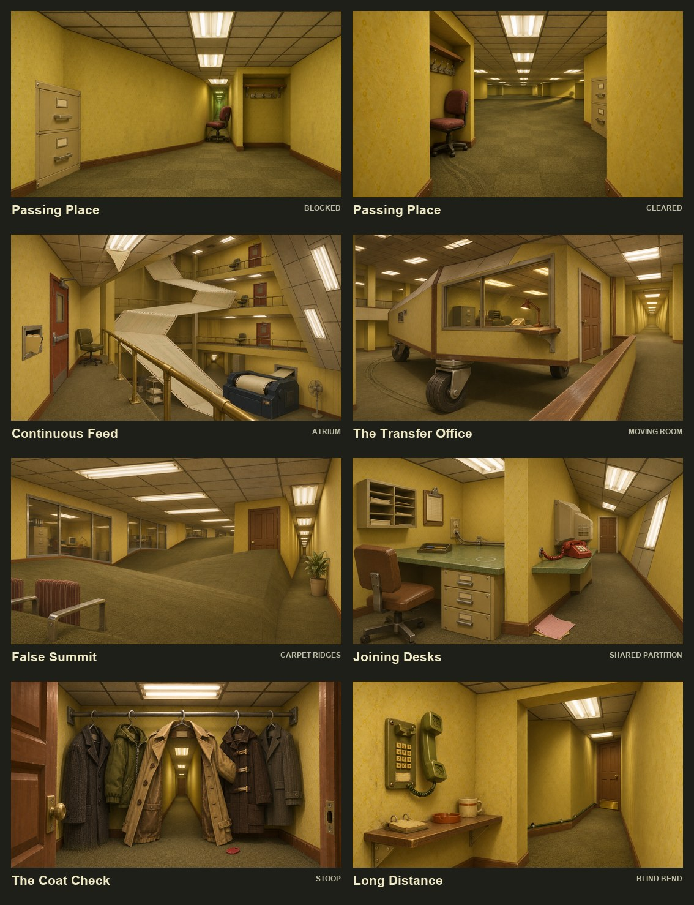
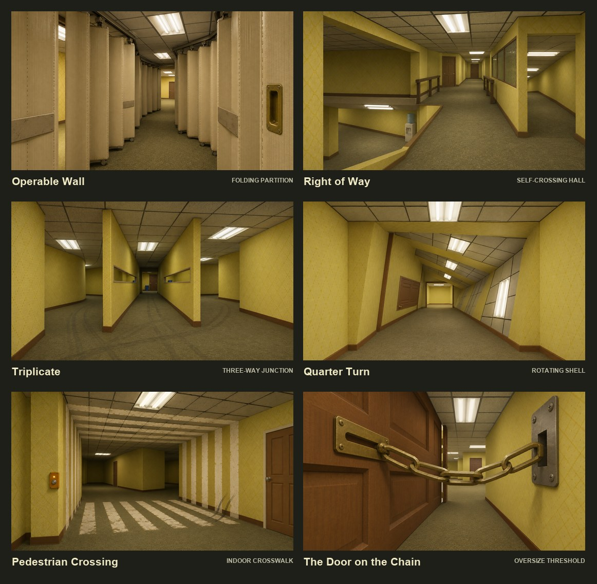
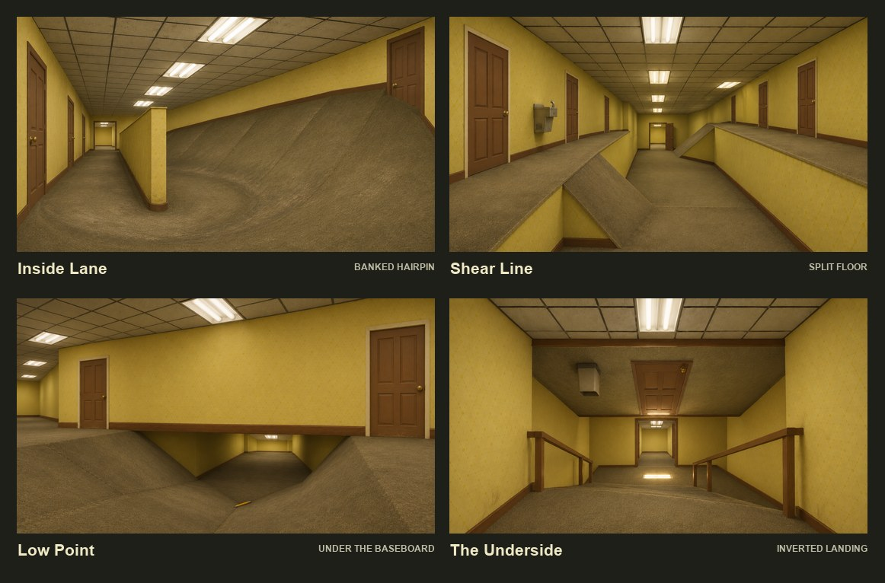

# BlockRooms art direction

## Level 1 · Yellow Office

**The Door on the Chain** is selected for the build. [Volume 1](yellow-office/README.md) contains the original 14 concepts.

[Volume 2 · Rooms that narrow](yellow-office/volume-2/README.md) contains eight full-size renders across seven spaces, including both sides of a movable-chair chase and the two visual references supplied for the batch.

