# Yellow Office · Volume 2

Seven proposed spaces and eight full-size renders. **Passing Place** has a second angle showing the chair after the player clears the lane.

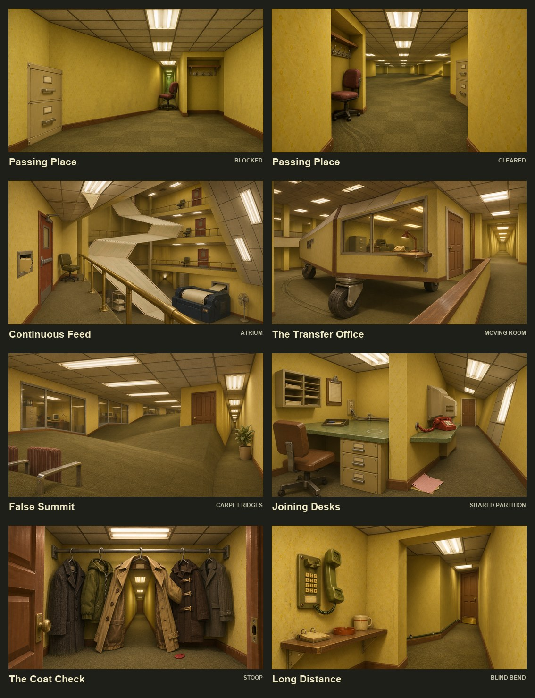

## Passing Place

A burgundy caster chair fills the narrowest point of the hall. Its wheels sit clear on the carpet. The filing drawers on the left are sunk into plaster. Grab the loose chair, pull it back past the short divider, turn, and park it under the coat hooks. Its old position is now a way out. In the chase variant, footsteps cross the broad room behind you as you reach the chair. Size the recess for the chair’s placement footprint on level carpet and leave the near side clear for a second player. The existing furniture interaction already handles grab, carry and release.

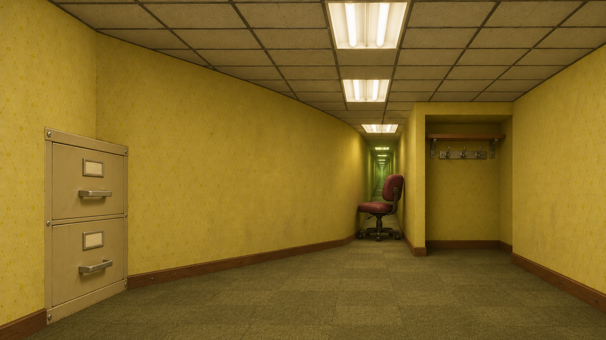

From inside the cleared lane, the chair is under the hooks on the left. The shadow reaches the open floor before the pursuer does.

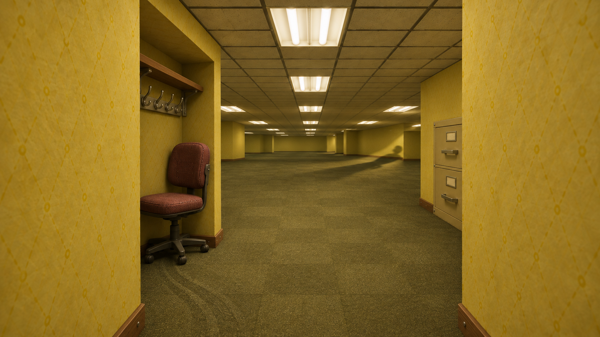

For the existing placement and release behavior, see [Furniture barricades](../../../BACKROOMS-BARRICADES.md).

## Continuous Feed

Enter at the middle balcony, where one normal task chair makes the scale of the feed paper obvious. Step onto the first fold. Follow the punched edges downward until they lead to a service slit beside the printer. For the first playable pass, align two broad paper faces and a forgiving landing with two real doors. The upper folds can disappear through the ceiling.

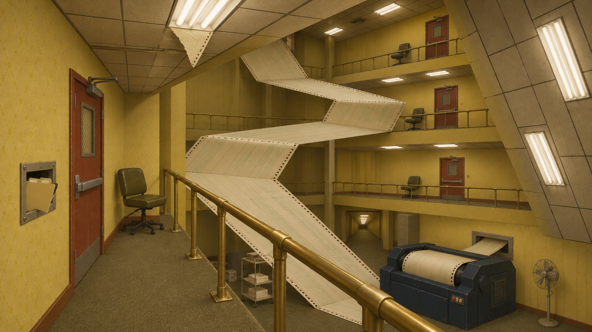

## The Transfer Office

The windowed office is the lift car. Board at one open door and use the lamp visible through its window as a landmark while the room rolls to another doorway. A dark gap moves past below the window before the next fluorescent hall comes into view. Begin with a parked office and two docking points to test scale and sightlines. Carrying players between docks would need a separate gameplay prototype.

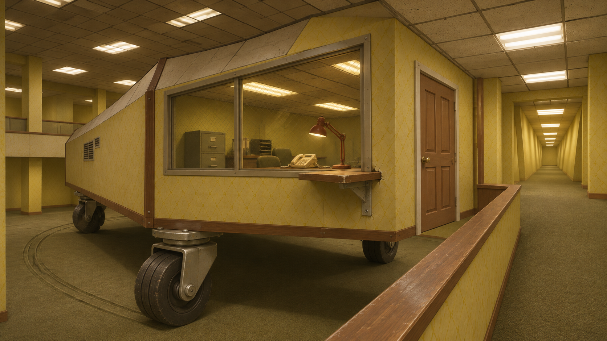

## False Summit

The carpet rises in broad ridges until it almost swallows an office door. Only the seat backs and chrome arms of two visitor chairs still break the surface in the foreground. Crest the first rise and look for the potted plant at the edge of the frame. The one-person lane beside it leads out. Carry the seams across each ridge and leave the two buried chairs fixed.

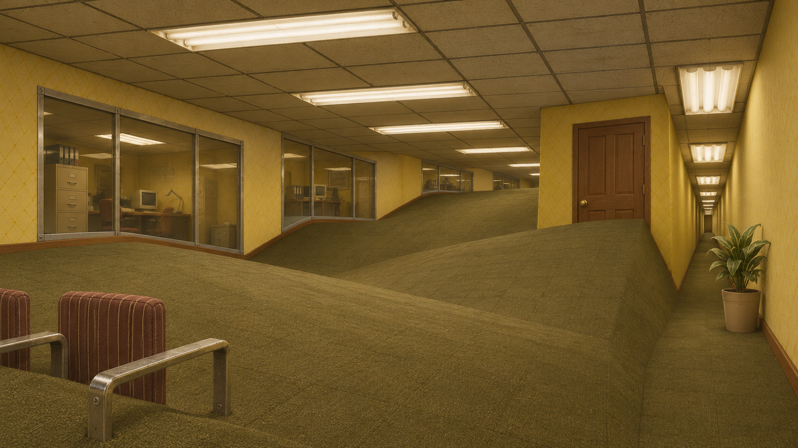

## Joining Desks

At first the green desk looks pushed up against a new partition. Walk around the end and find its matching laminate on the far face, complete with the red phone and the back of the CRT. Carry the thin edge of the desktop through both sides at exactly the same height. A scuffed drawer pull, ring marked by a coffee cup, and pink tractor-feed sheet draw the eye to the join. Set the embedded furniture as fixed dressing.

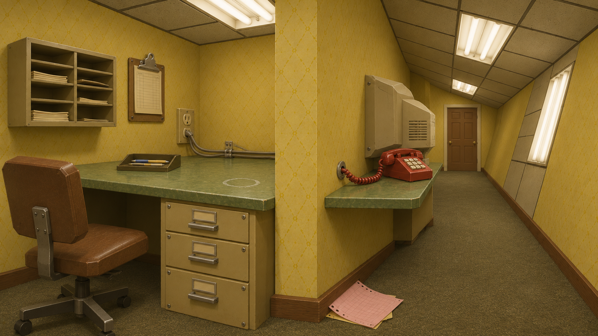

## Long Distance

A dial tone comes from a wall phone with its receiver still in the cradle. Follow the green cable as it disappears at skirting height, reappears, and rounds the blind bend. Put the onward passage beside the last door. Let the tone bleed through the partition so it changes direction before the player can see why.

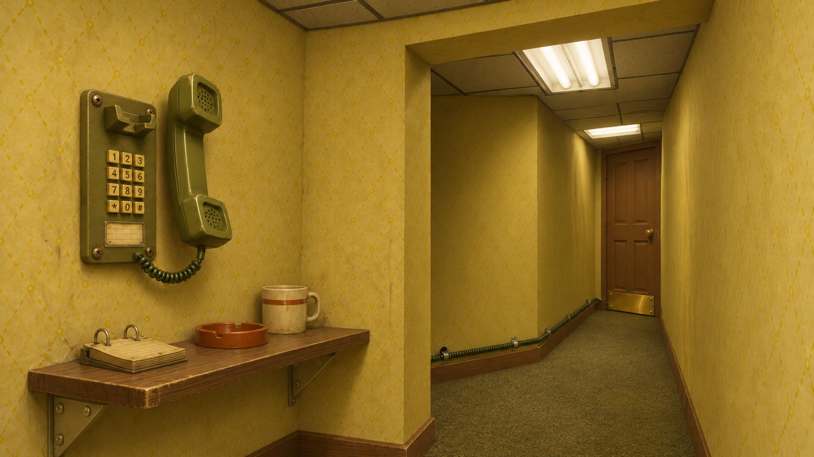

## The Coat Check

Five coats share a short rail. A dim fluorescent flickers between the lapels of the tan one. Duck below the rail and into a real corridor dressed with the coat as its opening. Use the same carpet and baseboard inside so the player can judge its depth. The sunk hem and wall-piercing sleeve set up the threshold before the player reaches it.

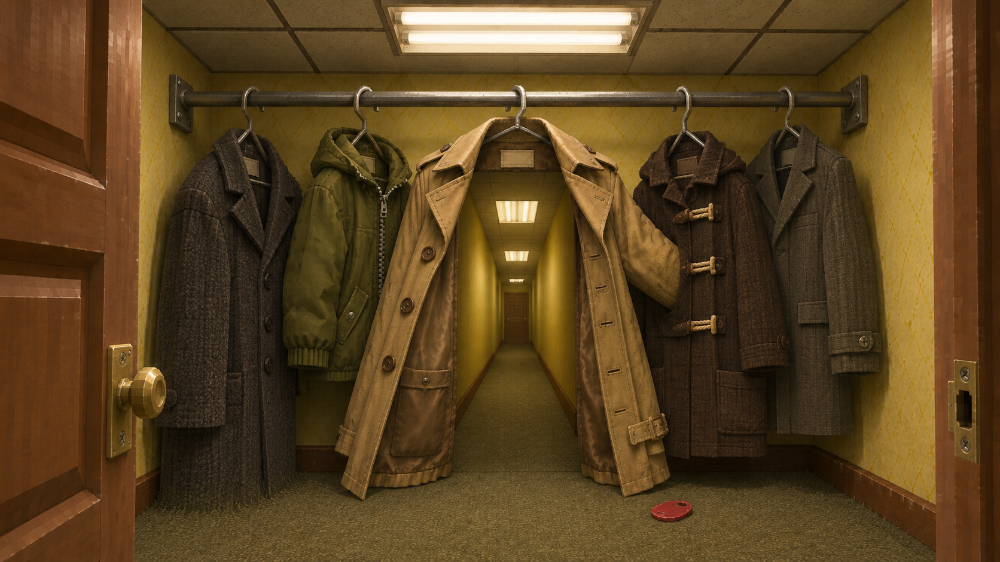

## Visual references

The narrowing sightline in the first reference and the half-buried, wall-piercing objects in the second guided this batch. The game’s Status Codes screenshot and the earlier [Quarter Turn study](../quarter-turn.png) anchored the Yellow Office materials.

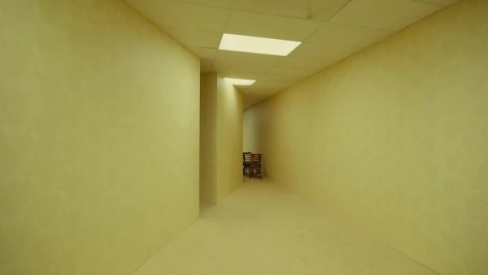

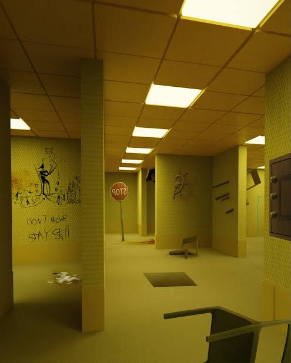
